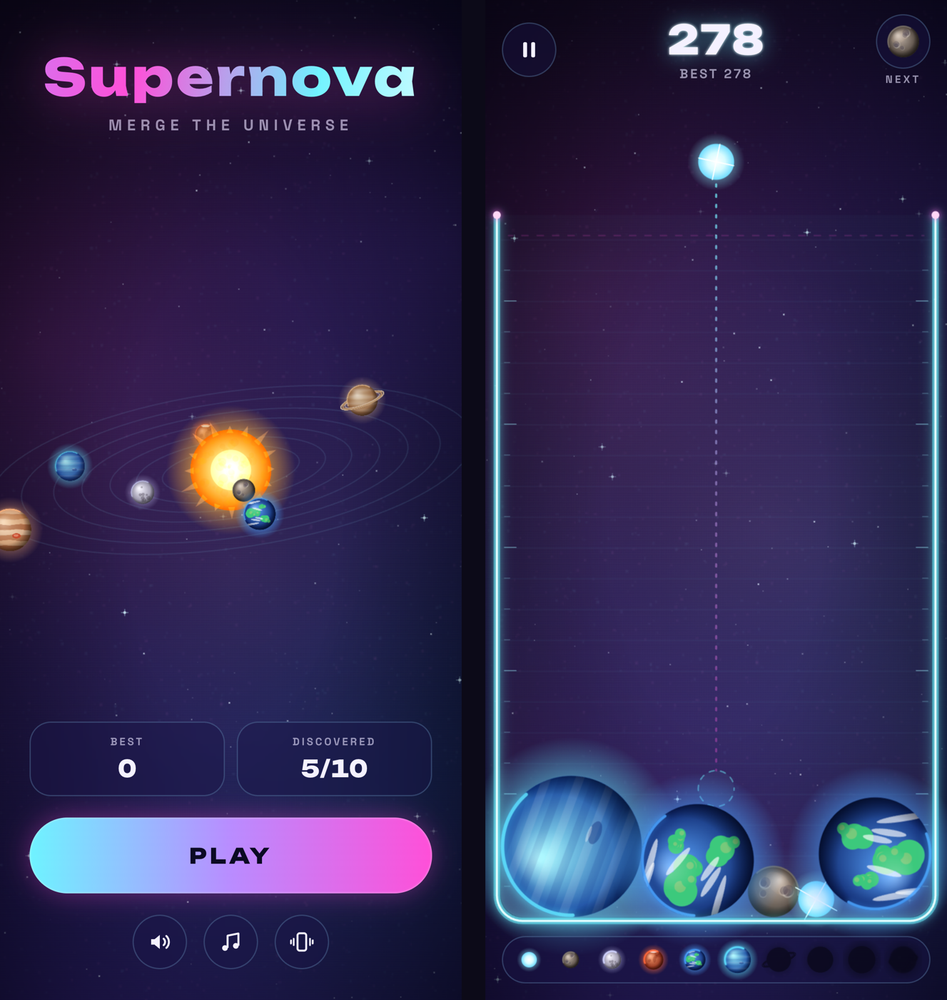

# Supernova

**A drop-and-merge physics game: drop and merge space objects, from comets to planets to stars, until the universe goes supernova.**
Built for iOS and Android on my own lightweight game engine.

> Heading to the app stores, so the code is private. This page shows how it is built.

## Features

- Real-time 2D physics: drop, bounce, merge, chain reactions
- Particle effects and screen shake on merges
- **Sound made in code** (Web Audio synth, no audio files)
- Menus, settings, saved best scores, haptics on phones

## How it's built

| Part | Tech |
|---|---|
| Engine | Shared JavaScript engine: physics, effects, sound synth, menus, saving. Reused for the next game. |
| Game | Vite web app |
| Mobile | Capacitor 8 → native iOS and Android projects (haptics, splash screen, status bar) |

## What I learned

- Build the engine once and keep the games thin. The next game (for kids) reuses the whole engine.
- Mobile performance means fewer objects and simpler effects, not fancier code.
